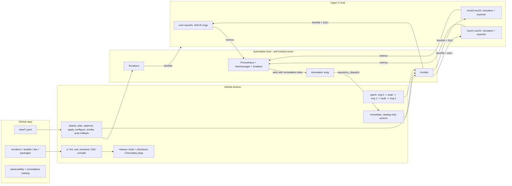

# campus-security-platform

Reference implementation of a **physical-security platform delivered as code**: one YAML file per campus, one pipeline run to stand it up, and automation that patches, monitors and repairs the fleet so a small on-call team can carry many sites.

It runs end to end in a home lab (Hyper-V on one Windows box, a Linux box as the automation host). The security application is a **labeled simulator** standing in for a commercial VMS / access-control head end such as Genetec Security Center; see [What is simulated](#what-is-simulated).



## Role scope -> implementation

| Responsibility | Where it lives | How it is met |
|---|---|---|
| IaC that stands up a site's entire platform; onboarding = pipeline run | [`sites/`](sites), [`terraform/`](terraform), [`ansible/`](ansible), [`dsc/`](dsc), [`packer/`](packer) | Adding `sites/<name>.yaml` (schema-validated) is the whole onboarding. Terraform builds VMs from a versioned golden image with per-site state; Ansible + PowerShell DSC converge them; the LCM auto-corrects drift every 15 min. Inventory **and** monitoring targets are generated from the same Terraform output, so nothing is configured but unmonitored. |
| Own CI/CD and the release path: tested, versioned, reversible | [`.github/workflows/`](.github/workflows) | `ci` gates every PR (pytest, ansible-lint production profile, terraform validate, PSScriptAnalyzer, DSC MOF compile, promtool rule unit tests, actionlint). `release` builds checksummed Chocolatey packages from a semver tag. Sites pin a release; `deploy` plans, waits for approval on infra changes, applies, configures, smoke-tests through Prometheus and **automatically rolls back** to the last known-good release. Revert the commit = roll back. |
| Automate remediation; anything done twice becomes code | [`remediation/`](remediation), [`ansible/remediation/`](ansible/remediation), [`observability/`](observability) | Alerts opt in with a `remediation` label; a relay turns them into audited Actions runs limited to [`remediation/catalog.yaml`](remediation/catalog.yaml), with cooldowns, hourly caps, payload re-validation, blast-radius guards and verification that the alert actually cleared. Hitting a cap pages a human. |
| Package and patch pipeline; nobody touches a host | [`packages/`](packages), [`.github/workflows/patch.yml`](.github/workflows/patch.yml), [`ansible/playbooks/patch_ring.yml`](ansible/playbooks/patch_ring.yml) | Third-party binaries are internalized and hash-pinned; hosts only install from the release they are pinned to. OS patches flow through WSUS target groups as rings: ring 0 picks the set, later rings get **exactly** that set after a soak, every ring is checkpointed first and restored automatically if the health gate fails. |
| Automation ahead of the platform; on-call stays small | everything above | Monitoring, rollback and remediation exist before the second campus does. The Grafana fleet view separates "needs a human" from "automation handled it" and tracks automated actions as toil avoided. |

## Repository layout

```
sites/                  one YAML per site + JSON schema (the onboarding interface)
fleet/firmware.yaml     desired device firmware (policy -> generated alert rules)
terraform/              hyperv-vm module + per-site stack (one state file per site)
packer/                 Windows Server 2025 Core golden image (patched, DSC modules baked)
dsc/                    CampusNode DSC configuration (baseline, WSUS client/server, rings)
ansible/                site convergence, patch rings, checkpoint rollback, remediations
packages/               Chocolatey packages: simulator service, internalized windows_exporter
simulator/              campus-sec-sim: stand-in VMS/access-control head end + device fleet
remediation/            catalog (allowlist) + Alertmanager->GitHub relay
observability/          Prometheus, Alertmanager, Grafana (compose), rules + rule tests
scripts/                pipeline glue (inventory/targets rendering, gates, staging), bootstrap
docs/                   architecture, ADRs, runbooks, lab setup
```

## Pipelines

| Workflow | Trigger | Runs on | Does |
|---|---|---|---|
| `ci` | PR, push to main, reused by others | GitHub-hosted | All static checks and unit tests; nothing touches the lab |
| `release` | tag `vX.Y.Z` on main | GitHub-hosted (Windows for packaging) | CI, PyInstaller build, verified upstream downloads, `choco pack`, SHA256SUMS, GitHub Release |
| `deploy` | push touching `sites/`, `terraform/`, `ansible/`, `dsc/`; manual per site | self-hosted `campus-lab` | Scope by changed files, core first, then one campus at a time; plan -> approve (infra only) -> apply -> configure -> smoke -> rollback |
| `patch` | Wednesday after Patch Tuesday; manual resume | self-hosted | Ring 0 -> soak -> ring 1 -> soak -> ring 2, checkpoint + auto-restore |
| `remediate` | `repository_dispatch` from the relay | self-hosted | Validate payload, run catalog playbook on one host, confirm alert cleared |
| `observability` | push touching rules/relay/fleet policy | self-hosted | CI, then compose up + config reload + health checks |
| `teardown` | manual, site name typed twice | self-hosted | Destroy a campus and drop it from inventory and monitoring |
| `image` | manual | optional Windows runner on the Hyper-V host | Build and publish an immutable golden image |

## What is simulated

| Real platform | Here | Why |
|---|---|---|
| Genetec Security Center (Directory, Archivers, Access Manager) | `campus-sec-sim` Windows service: device inventory, access events, firmware, reboot and fault-injection API, Prometheus metrics | Licensed, closed software cannot ship in a public repo. The automation targets the same shapes: a Windows service, a management API, device health and firmware. |
| Cameras, door controllers, readers | Simulated devices inside the service | Same lifecycle events (offline, firmware drift, not recording) drive real alerts and real remediations. |
| Intune / Windows Update for Business | WSUS rings on a core server | Intune needs a tenant. The ring/gate/promotion logic is the same; [ADR-0004](docs/adr/0004-patch-rings-wsus-intune.md) maps each step to the Intune/Graph equivalent. |

## Getting started

1. Lab prerequisites and one-time host setup: [`docs/lab-setup.md`](docs/lab-setup.md).
2. Build the golden image on the Hyper-V host: `scripts/build-golden-image.ps1`.
3. Tag `v1.0.0` to publish the first release.
4. Run `deploy` for `core`, then merge `sites/hou-01.yaml` (already present) or dispatch it.
5. Add a campus: copy `sites/hou-02.yaml` to `sites/<new>.yaml`, change names, open a PR.

Game day (break things on purpose and watch the platform fix them): [`docs/runbooks/game-day.md`](docs/runbooks/game-day.md).

## Known trade-offs

Called out where they live in the code; summarized in [`docs/architecture.md#trade-offs`](docs/architecture.md#trade-offs). The big ones: self-signed WinRM certificates (lab), local Terraform state on the automation host, a single self-hosted runner as the only path to the lab, a per-host folder feed instead of an HTTP package feed, a community Hyper-V provider with low recent activity, and WSUS being deprecated by Microsoft.

## License

MIT. Not affiliated with Genetec, Microsoft or Chocolatey Software.
